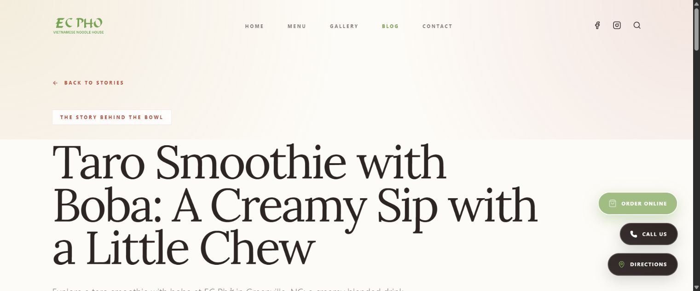

# Năm bài món ăn bổ sung — 25/10/2026

**Ngày:** 2026-10-25

**Phạm vi:** Taro Smoothie with Boba, 3 Bean Dessert, Lemongrass Beef with Vermicelli, Grilled Pork Chop and Egg with Steamed Rice, General Tso’s Chicken with Steamed Rice.

**Trạng thái:** Đã biên soạn và kiểm tra local; trạng thái merge/deploy được xác nhận riêng trong PR.

[Chỉ mục tài liệu](./README.md) · [Changelog](./CHANGELOG.md) · [Bằng chứng](./evidence/2026-10-25/blog-additions/README.md).

## Nội dung và SEO

Thêm năm bài tiếng Anh ở đầu danh sách, ngày đăng 25/10/2026. Blog có tổng 20 bài. Kiểm tra tự động xác nhận cả 15 bài đã có vẫn giữ nguyên dữ liệu, nội dung và ngày đăng; các bài 16/10 không bị đổi sang ngày mới.

| Bài / slug sau `/blog/` | Từ khóa chính | Số từ |
| --- | --- | --- |
| `taro-smoothie-boba-greenville-nc` | taro smoothie with boba Greenville NC | 424 |
| `three-bean-dessert-greenville-nc` | three bean dessert Greenville NC | 411 |
| `lemongrass-beef-vermicelli-greenville-nc` | lemongrass beef vermicelli Greenville NC | 405 |
| `grilled-pork-chop-egg-rice-greenville-nc` | grilled pork chop egg rice Greenville NC | 412 |
| `general-tsos-chicken-steamed-rice-greenville-nc` | General Tso chicken Greenville NC | 409 |

Mỗi bài có title SEO, meta description, keyword bổ trợ, alt ảnh, bốn H2 nội dung và ba bài liên quan. Hệ thống BlogPosting / BreadcrumbList / canonical sẵn có được tái sử dụng. Thêm năm URL vào sitemap, cập nhật lastmod trang Blog. Từ khóa được chọn theo món và địa điểm, không kèm số liệu lượng tìm kiếm hay cam kết thứ hạng.

Hai bài về beef vermicelli có trọng tâm khác nhau: bài cũ nói grilled beef; bài mới nói sautéed lemongrass beef. Chúng liên kết tới nhau để người đọc so sánh cách chế biến.

## Dữ kiện món và ảnh

Nguồn chính là tên món chủ nhà hàng cung cấp, dữ liệu `src/data/menu.ts` và ảnh hiện có trong repo. Đã mở xem từng ảnh trước khi chọn:

- Taro: `drinks/taro.jpg`, có boba; nối tới Fruit Smoothie / Drinks, nơi có lựa chọn Taro và extras boba.
- Three-bean dessert: `drinks/3-bean.jpg`, nối tới món `d94`.
- Lemongrass beef vermicelli: `bun/037.jpg`, nối tới món `b37`.
- Pork chop + egg: `rice/047.jpg`, ảnh có sườn, trứng và cơm trắng.
- General Tso’s Chicken: `specials/general-tsos-chicken.jpg`, ảnh có cơm trắng riêng.

Hai món cuối chưa có dòng riêng trong dữ liệu menu hiện tại. `BlogPost.menuLink` cho phép bài dẫn đến nhóm Rice Plates / House Specials với nhãn chung, không gán nhầm menuItemId và không thêm giá hay món mới vào catalog. Liên kết bài cũ dùng menuItemId giữ nguyên cách hiển thị.

Không tải ảnh mới từ bên ngoài hoặc tự gán giấy phép/tác giả ảnh. Tái sử dụng ảnh repo không phải kiểm tra lại quyền sở hữu toàn bộ kho ảnh. Không khẳng định nguyên liệu bí truyền, loại sữa, mức cay, dinh dưỡng hoặc khả năng điều chỉnh món chưa được xác nhận.

Đối chiếu bối cảnh ẩm thực: [Vietnam Tourism về chè](https://vietnam.travel/node/195) và [Smithsonian về General Tso’s Chicken](https://www.smithsonianmag.com/smart-news/general-tsos-chicken-got-its-start-fine-dining-180956795/). Các bài viết mới dùng lời riêng, không lấy công thức hoặc đoạn văn từ những nguồn đó; General Tso’s Chicken được mô tả là món quen thuộc trong ẩm thực Chinese American.

## Rà trùng lặp

- So sánh chuỗi 12 từ liên tiếp của mỗi bài mới với 19 bài còn lại: không có đoạn trùng theo phép kiểm tra này.
- Tìm 10 câu mẫu trên web, hai câu mỗi bài: không thấy câu nguyên văn hoặc chuỗi 12 từ của các mẫu trong văn bản kết quả trả về.
- Giới hạn: công cụ tìm kiếm có thể nới dấu ngoặc kép; chỉ so sánh các mẫu và nội dung kết quả tìm kiếm, không quét toàn văn trên web hoặc cơ sở dữ liệu riêng. Không có điểm originality hay chứng nhận Turnitin/Copyscape.

Chi tiết: [content-checks.json](./evidence/2026-10-25/blog-additions/content-checks.json), [originality-samples.json](./evidence/2026-10-25/blog-additions/originality-samples.json), [web-originality-checks.json](./evidence/2026-10-25/blog-additions/web-originality-checks.json).

## Kiểm thử

- TypeScript `--noEmit` và kiểm tra whitespace Git đạt.
- Tổng 20 bài / năm bài mới; slug duy nhất; 15 bài cũ giữ nguyên; đủ ảnh tối ưu 480/960 px, menu item / category, bài liên quan và URL sitemap.
- Browser Chrome local, viewport mặc định 1536 px: năm bài đều có một H1, bốn H2 nội dung, ảnh tải thành công, canonical / title / description và hai loại schema đúng, không tràn ngang.
- Liên kết nhóm món từ General Tso’s Chicken mở đúng `/menu#house-specials` và active House Specials.
- Không có console error trong lượt kiểm tra browser. Không kiểm tra riêng viewport mobile hoặc Safari/Firefox trong lượt này.
- Ảnh kiểm chứng cuối là bài Taro, đã ghi đè ảnh chụp thử trước đó trong cùng file.

## File và tác dụng phụ

Source sửa: `src/data/dishStories.ts`, `src/data/blog.ts`, `src/pages/BlogPostDetail.tsx`, `public/sitemap.xml`; nội dung và mtime đổi. Cập nhật chỉ mục/changelog và thêm báo cáo, JSON, ảnh kiểm chứng trong docs. Thuộc tính Git giữ nguyên byte bằng chứng; manifest ghi SHA256 và kích thước.

Tạo cache `node_modules/.cache/ecpho-blog-audit-20261025` cho baseline, script kiểm tra, kết quả local, PID và log. Các JSON kiểm tra được ghi lại khi chạy lại; ảnh chụp thử bị ghi đè bằng ảnh cuối. Không sửa ảnh nguồn, dữ liệu menu hay các file source đang dở từ trước.

Vite dev cập nhật mtime thư mục `node_modules/.vite-temp` khi nạp config tạm. Kiểm kê sau lượt kiểm tra không có file cache mới còn lại trong `.vite` / `.vite-temp` có mtime từ lúc server được mở.

Mở tạm server local PID 34736, sau đó dừng server và ba tiến trình con; netstat không còn dòng port 3000 khi kiểm tra dừng. Bằng chứng: [server-stop.json](./evidence/2026-10-25/blog-additions/server-stop.json). Hai tab Chrome kiểm tra local đã đóng; tab website công khai được giữ. Không đặt viewport override.

Không chạy build local hoặc cài dependency; dist được đối chiếu với baseline để ghi nhận tác động. Git commit/push/merge kích hoạt kiểm tra và triển khai tự động của repository; kết quả được báo cùng PR. Kiểm tra local không tự xác nhận bài đã xuất hiện trên domain công khai hoặc được Google index.
