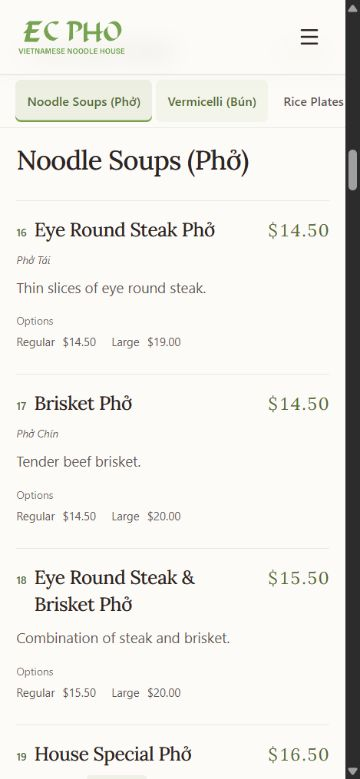

# EC Phở Menu — báo cáo thay đổi và kiểm chứng

**Ngày kiểm chứng:** 2026-10-16

**Phạm vi:** giao diện Menu, carousel ảnh, typography, thanh danh mục và cuộn section

**Trạng thái:** Lưu trữ kiểm chứng — tổng hợp và lưu vào docs ngày 2026-10-25

[Chỉ mục tài liệu](./README.md) · [Bằng chứng](./evidence/2026-10-16/README.md) · [Nhật ký gốc các vòng chỉnh](./evidence/2026-10-16/menu/audit.md).

Mã thay đổi có trong commit `d049fc4` trên `main`. Báo cáo này ghi lại các kiểm tra local ngày 16/10; lần rà soát tài liệu 25/10 không chạy lại browser hoặc xác nhận website công khai.

## Trạng thái cuối của Menu

- H1, tiêu đề tab, Open Graph và Twitter title là chính xác **EC Phở Menu**. `SEOHead` có tùy chọn `appendBrand`, riêng Menu tắt hậu tố thương hiệu.
- Câu giới thiệu giữ nguyên nội dung, dùng Lora nghiêng nhẹ, 15–18 px, vùng chữ tối đa 1040 px. Ở các chiều rộng 756/768/1280/1440 px đã kiểm tra, câu nằm trên một dòng. Trên mobile 375–430 px, câu tự xuống 2–3 dòng để không tràn ngang.
- Dải ảnh tự chạy 50 giây với 8 ảnh khác nhau và một nhóm lặp để nối vòng. Hai nhóm có tổng 16 ảnh đã decode trong lần kiểm tra. Hover dừng ảnh; reduced motion dừng animation và cho cuộn ảnh thủ công.
- Danh sách món dùng tên / giá theo cột, divider nhẹ, mô tả và biến thể dễ đọc; giữ nguyên dữ liệu 80 món. Không dùng hiệu ứng hover khiến món trông như nút bấm.
- Desktop có sidebar; mobile/tablet có thanh danh mục ngang sticky, vùng chạm tối thiểu 44 px. Offset theo chiều cao header thực tế để heading không bị che.
- Chọn section cuộn trang trong 240 ms; thao tác chọn mới hoặc cuộn thủ công hủy animation trước. Scrollspy theo dõi vị trí đọc, dùng vị trí section được đo lại khi layout thay đổi.
- Dưới 640 px, mục đang chọn được đưa về cách mép trái 16 px, giúp mục kế tiếp hiện ra. Chạm lại mục đang chọn sau khi tự kéo thanh cũng căn lại; ở đầu/cuối thanh, trình duyệt giới hạn trong vùng cuộn có thật.
- Order online / Call us / Directions nằm trong phần đầu Menu. Các nút nổi chỉ ẩn tại `/menu` để không che giá; trang khác giữ hành vi sẵn có.

## Kiểm chứng đã lưu

| Phần | Kết quả ngày 16/10 | Bằng chứng |
| --- | --- | --- |
| Nội dung món | 80 món kỳ vọng, 80 món render, không có khác biệt dữ liệu | [content-check.json](./evidence/2026-10-16/menu/content-check.json) |
| Layout và điều hướng vòng đầu | 375/390/430/768/1280/1440 px; kiểm tra tràn ngang, tên/giá, đổi section và cuộn | [browser-checks.json](./evidence/2026-10-16/menu/browser-checks.json) |
| Dải ảnh sau khi khôi phục | Chuyển động ở sáu viewport, hover pause, reduced motion | [marquee-restored-checks.json](./evidence/2026-10-16/menu/marquee-restored-checks.json) |
| Tiêu đề cuối | document title / H1 / OG / Twitter đúng EC Phở Menu | [menu-title-verified.json](./evidence/2026-10-16/menu/menu-title-verified.json) |
| Câu giới thiệu | Một dòng ở các chiều rộng đã nêu, mobile không tràn | [menu-intro-checks.json](./evidence/2026-10-16/menu/menu-intro-checks.json) |
| Thanh mục mobile | 21 lần chọn liên tiếp / quay lại tại 375/390/430 px đạt | [mobile-category-next-checks.json](./evidence/2026-10-16/menu/mobile-category-next-checks.json) |
| Kéo thanh và chọn lại | scrollLeft 156 → 0 → 156, scrollY giữ 2617.6; reduced motion chọn Bún, thấy Rice Plates | [mobile-category-next-extra-checks.json](./evidence/2026-10-16/menu/mobile-category-next-extra-checks.json) |
| Build / production vòng đầu | Vite và esbuild thành công, mở bản production ở mobile và desktop | [production-check.json](./evidence/2026-10-16/menu/production-check.json) và [nhật ký gốc](./evidence/2026-10-16/menu/audit.md) |
| File / cache vòng đầu | Dist gốc 305 file không đổi hash, kích thước và mtime so với baseline lúc đó | [filesystem-check.json](./evidence/2026-10-16/menu/filesystem-check.json) |

Các lần đổi tiêu đề, câu giới thiệu, khôi phục ảnh chạy và căn thanh mục xảy ra sau build vòng đầu; không dùng kết quả production vòng đầu để khẳng định mọi thay đổi cuối đã được kiểm tra production. TypeScript `--noEmit` và kiểm tra whitespace Git đã đạt sau các lượt sửa source tương ứng.

[Ảnh desktop của dải ảnh đã khôi phục](./evidence/2026-10-16/menu/marquee-restored-desktop.jpg).

## File và tác dụng phụ của lượt làm Menu

Source liên quan: `src/pages/Menu.tsx`, `src/pages/Menu.css`, `src/layouts/shared/FloatingActions.tsx`, `src/layouts/shared/SEOHead.tsx`. Nội dung / mtime các file này đổi; dữ liệu món, header, footer, API và database không được sửa trong phạm vi lượt Menu.

Build kiểm thử dùng thư mục riêng trong cache. Bản build kiểm thử trước đã bị xóa và tạo lại ở lần build sau; sau khi kiểm tra, thư mục build kiểm thử đã được xóa. Dist gốc không bị ghi đè trong lượt đó. Kết quả file/cache là số liệu lịch sử trong JSON đã dẫn, không phải kiểm kê filesystem ngày 25/10.

Các server thử nghiệm của vòng đầu đã dừng; sau đó server local port 3000 được mở theo yêu cầu xem local. Nhật ký gốc có PID, log và các mốc khác nhau. Không suy ra trạng thái tiến trình hiện tại từ những PID lịch sử này.

## Giới hạn và nội dung cần đọc tiếp

Kiểm tra trình duyệt thực hiện bằng Chromium local; chưa chứng nhận Safari/Firefox hoặc thiết bị vật lý. Cảnh báo bundle ở build vòng đầu còn tồn tại. Tài liệu này không xác nhận deploy, DNS, Google index hoặc thứ hạng tìm kiếm.

Với 10 bài món ăn mới và SEO blog, đọc [báo cáo nội dung blog](./blog-content-review-2026-10-16.md). Audit routing tháng 8 được giữ tại [navigation-audit.md](./navigation-audit.md) để tra lịch sử; mô tả cơ chế Menu trong đó có thể đã được thay thế bởi lượt tháng 10.
